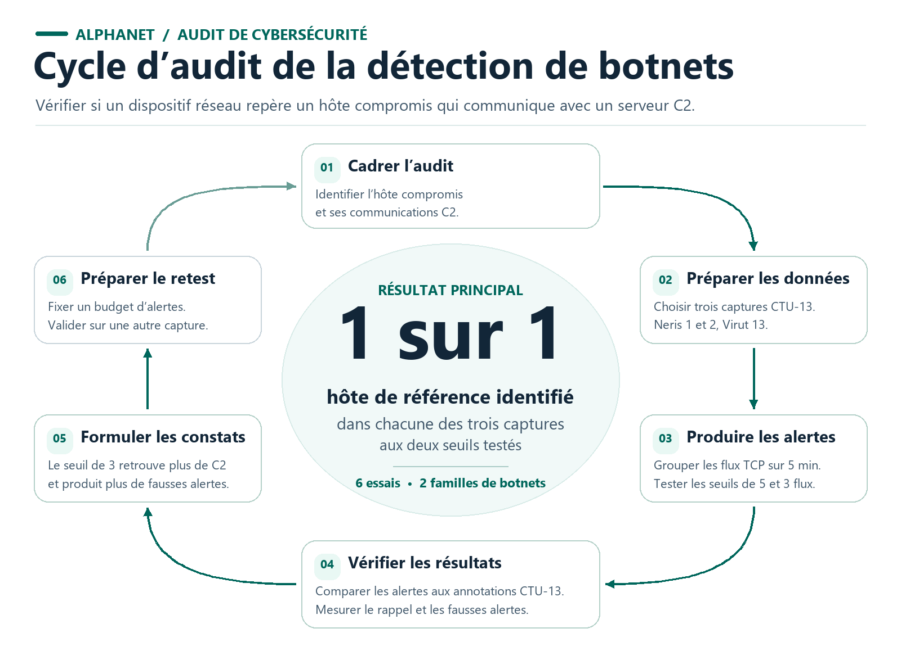

# ALPHANET — Audit de la détection de botnets

**Un détecteur réseau peut-il identifier un hôte compromis qui communique avec un serveur C2 ?**

ALPHANET est un projet d’audit en cybersécurité qui évalue cette capacité sur trois captures historiques de **CTU‑13**. J’ai comparé deux seuils de détection sur les mêmes données pour mesurer trois choses&nbsp;: l’identification de l’hôte, la couverture de ses communications C2 et les fausses alertes sur le trafic de référence normal.

> **Résultat principal** — Les deux seuils ont identifié l’unique hôte C2 de référence dans chacune des trois captures. Le seuil de **3 flux** a retrouvé davantage de communications C2 et généré davantage de fausses alertes sur les groupes annotés exclusivement **Normal**.

## Périmètre de l’audit

| Capture CTU‑13 | Famille | Rôle dans l’évaluation |
| --- | --- | --- |
| Scénario 1 | Neris | Pilote et choix des seuils à comparer |
| Scénario 2 | Neris | Validation sur une autre capture de la même famille |
| Scénario 13 | Virut | Validation sur une famille différente |

L’évaluation porte sur des **flux TCP analysés hors ligne** et sur les communications C2 qui disposent d’un marqueur explicite dans CTU‑13. Ces marqueurs, comme `CC6` ou `CC16`, servent de référence pour évaluer les alertes.

## Comment fonctionne le test T‑01

1. **Regrouper les flux TCP.** Un groupe partage l’IP source, l’IP de destination, le port de destination et le début d’un créneau fixe de **5 minutes**.
2. **Produire les alertes.** La règle déclenche une alerte dès qu’un groupe atteint **5 flux**, puis l’évaluation est rejouée avec un seuil de **3 flux**. À cette étape, la règle utilise les champs réseau et l’heure.
3. **Vérifier les alertes.** Une seconde lecture utilise les annotations CTU‑13 pour établir les groupes C2 de référence et les groupes composés uniquement de trafic annoté `Normal`. Les alertes sont rapprochées de cette référence à partir de la même clé de groupement.

| Indicateur | Ce qu’il mesure |
| --- | --- |
| **Hôtes identifiés** | Hôtes de référence pour lesquels au moins un groupe C2 a été retrouvé, rapportés au nombre d’hôtes C2 de la capture. |
| **Rappel C2** | Groupes C2 retrouvés, rapportés à tous les groupes C2 de référence. |
| **Taux de fausses alertes sur Normal** | Groupes exclusivement `Normal` ayant déclenché une alerte, rapportés à tous les groupes exclusivement `Normal`. |

Les alertes en dehors de ces deux populations de référence sont classées comme **indéterminées**. Elles restent comptabilisées séparément.

## Résultats des six essais

| Capture | Hôte identifié aux deux seuils | C2 retrouvés · 5 flux | C2 retrouvés · 3 flux | Fausses alertes sur Normal · 5 flux → 3 flux |
| --- | :---: | ---: | ---: | ---: |
| **Neris 1** | 1/1 | 79/243 · **32,51 %** | 121/243 · **49,79 %** | 24,54 % → 41,94 % |
| **Neris 2** | 1/1 | 49/155 · **31,61 %** | 72/155 · **46,45 %** | 32,60 % → 57,93 % |
| **Virut 13** | 1/1 | 29/242 · **11,98 %** | 46/242 · **19,01 %** | 39,50 % → 68,32 % |

Sur **Virut**, abaisser le seuil retrouve **17 groupes C2 supplémentaires**. Le taux de fausses alertes sur les groupes `Normal` augmente de **28,82 points**. L’hôte identifié reste le même. C’est le compromis que le SOC doit évaluer avant de choisir un seuil.

## Une preuve concrète

Dans **Neris 1**, deux communications du même hôte apparaissent dans le même créneau de cinq minutes. Leurs correspondants et leurs ports les placent dans deux groupes distincts.

| Communication de référence | Flux TCP dans le groupe | Effet du seuil |
| --- | ---: | --- |
| **CC6** · port de destination 888 | 5 | Groupe retrouvé, le seuil de 5 est atteint. |
| **CC16** · port de destination 80 | 1 | Groupe manqué, un seul flux reste sous les deux seuils. |

Cette investigation explique pourquoi un résultat de **1/1 à l’échelle de l’hôte** peut s’accompagner d’un rappel bien plus faible à l’échelle des communications.

## Constats et recommandations

| Constat | Risque pour le SOC | Action proposée |
| --- | --- | --- |
| **Couverture C2 partielle.** Au seuil de 5, 213 des 242 groupes C2 de Virut sont manqués. | L’analyste peut identifier l’hôte et manquer une partie de son activité C2. | Évaluer un signal complémentaire pour les communications peu fréquentes sur une capture réservée au retest. |
| **Hausse des fausses alertes au seuil de 3.** Le taux augmente dans les trois captures. | La charge de tri peut retarder l’examen des alertes pertinentes. | Fixer une couverture cible et un budget d’alertes avec le SOC. Comparer les réglages selon ces deux critères. |

## Limites de l’évaluation

- Chaque capture contient **un seul hôte C2 de référence**, avec la même IP observée dans les trois captures. La détection de plusieurs hôtes compromis simultanément reste à évaluer.
- Le rappel est calculé sur les groupes TCP portant un marqueur C2 explicite. Le taux de fausses alertes s’applique à la sous-population exclusivement annotée `Normal`.
- L’évaluation repose sur des captures historiques. Le délai de déclenchement et la charge réelle de traitement en production restent à mesurer.

## Références

- [Stratosphere Laboratory — CTU‑13 Dataset](https://www.stratosphereips.org/datasets-ctu13)
- García, S., Grill, M., Stiborek, J. et Zunino, A. (2014). [An empirical comparison of botnet detection methods](https://doi.org/10.1016/j.cose.2014.05.011). *Computers & Security*, 45, 100–123.
